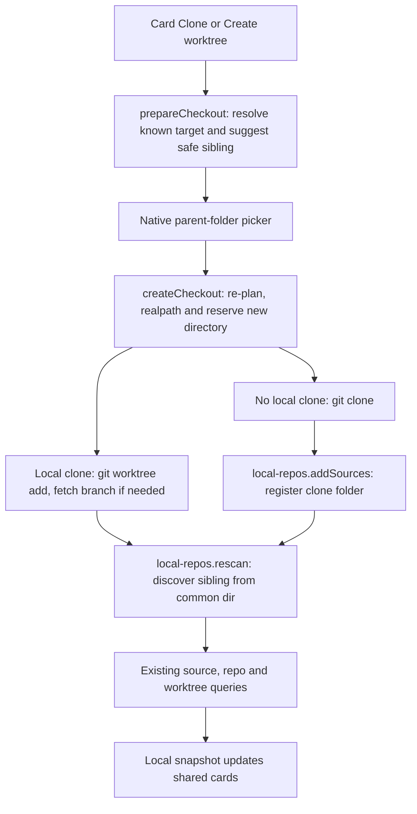
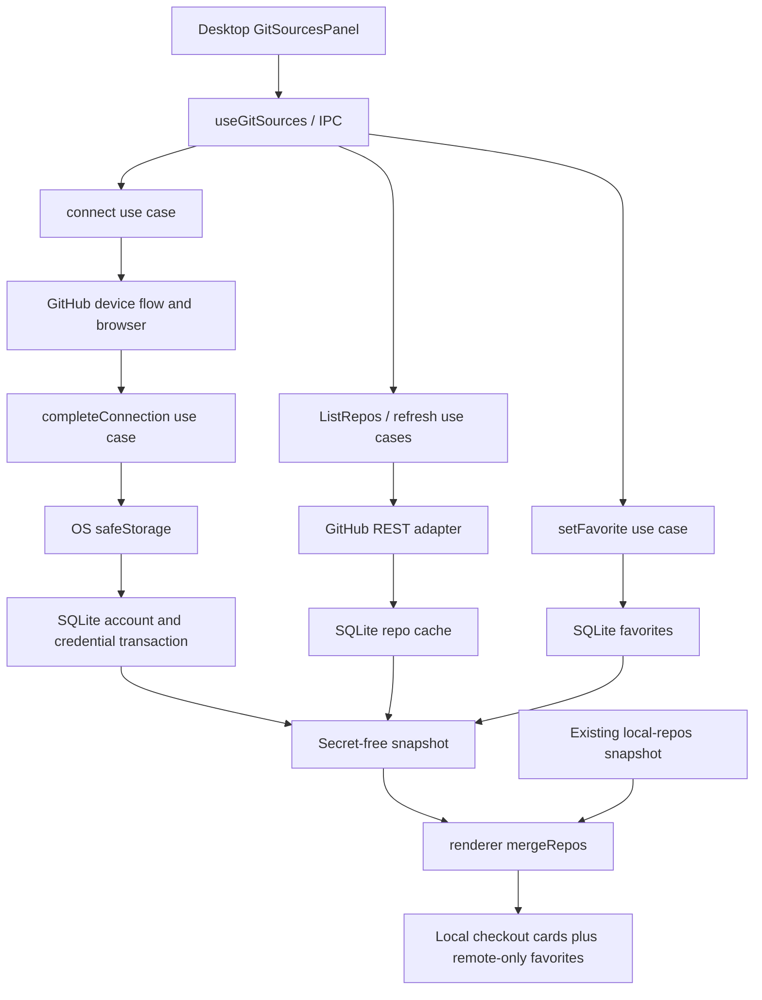
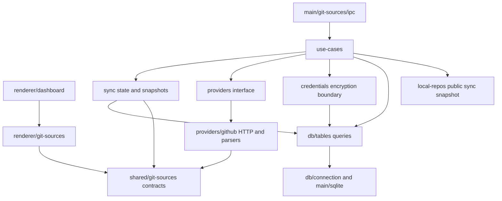
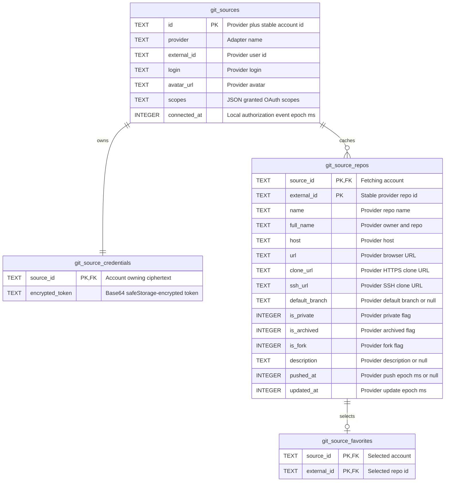

# PR review: Git sources / GitHub device connection

## 1. Summary

Adds provider-ready connected Git accounts under `src/main/git-sources`, with GitHub.com device authorization first.
The desktop displays local clones plus explicitly selected app favorites, never every accessible repo.
Tokens stay in main, OS-encrypted in SQLite; local paths/worktrees stay in the existing local repo feature.
Adds a paginated favorites picker, folder documentation, database scenarios and an executable isolated regression harness.
Review baseline: implementation changes relative to the preceding `origin/main`, including the new files listed below. This guide documents the implementation and does not assert remote PR status.

## 2. File structure

`+` new, `~` changed. No moves/deletions. Unrelated pre-existing `.claude/worktrees/` is excluded.

```text
~ AGENTS.md                                       records the isolated verification command
~ docs/README.md                                  indexes all feature docs
+ docs/reviews/pr-git-sources.md                   this review guide, included with the implementation
+ git-sources-plan.md                             implementation decisions and sequence
~ scripts/generate-db-schema.mjs                  registers the new Drizzle DB
+ scripts/check-git-sources.mjs                   bundle/run tests in isolated Electron Node runtime
+ scripts/git-sources.test.ts                     executable persistence/device/API/merge scenarios
+ scripts/checkout.test.ts                        real Git/placement/scanner/SQLite checkout scenarios
~ src/main/git/run.ts                            optional per-process env for scoped HTTP credentials
~ src/main/git/index.ts                          exports checkout commands
~ src/main/git/README.md                         documents new commands
+ src/main/git/commands/checkout.ts               branch validation, clone and linked worktree commands
~ src/main/local-repos/db/tables/README.md        checkout source/scan write scenarios
~ src/main/index.ts                              registers initGitSourcesIpc after local repos
+ src/main/git-sources/
  + README.md                                    feature behavior, setup and security boundary
  + ipc.ts                                       thin validated handlers and broadcasts
  + checkout/
    + README.md                                  safe sibling placement, reservation and scenarios
    + index.ts                                   folder names, parent validation and exclusive mkdir
    + url.ts                                     validate pasted HTTPS/SSH GitHub repo roots and canonical identity
  + credentials/
    + README.md                                  encryption boundary
    + index.ts                                   OS keychain checks, encrypt/decrypt
  + providers/
    + README.md                                  adapter extension point
    + types.ts                                   main-only adapter/credential contracts
    + index.ts                                   getProvider dispatch
    + github/
      + README.md                                GitHub endpoints and failure behavior
      + index.ts                                 GitHub adapter and account identity
      + request.ts                               single timeout/abort-aware HTTP transport
      + device-flow.ts                           begin and poll device authorization
      + repos.ts                                 REST repo mapping and bounded reads
  + sync/
    + README.md                                  runtime ownership and lifecycle
    + index.ts                                   public runtime API
    + authorization.ts                           single pending flow and shared completion promises
    + snapshot.ts                                public DB reads and EventEmitter subscriptions
  + use-cases/
    + README.md                                  action ownership
    + index.ts                                   public action exports
    + open-url.use-case.ts                       validated GitHub URL → OS default browser
    + connect.use-case.ts                        check keychain, request code, open browser
    + complete-connection.use-case.ts            authorize, identify, encrypt and save
    + cancel-connection.use-case.ts              abort pending flow
    + list-repos.use-case.ts                     validate page, fetch/cache catalog page
    + set-favorite.use-case.ts                   validate repo, persist explicit preference
    + refresh.use-case.ts                        refresh local primary remotes + favorites
    + prepare-checkout.use-case.ts               resolve target, validate branch and suggest sibling parent
    + create-checkout.use-case.ts                clone/worktree, local registration and error reporting
    + disconnect.use-case.ts                     cancel flow, delete local account data
  + db/
    + README.md                                  connection and transaction conventions
    + connection.ts                              lazy git-sources.db handle
    + schema.ts                                  table exports
    + drizzle.config.ts                          DDL generation input
    + create-tables.generated.ts                 generated create-if-missing statements
    + tables/
      + README.md                                examples, commented ER, writes and verified scenarios
      + git-sources/
        + README.md                              account lifecycle
        + schema.ts                              account table and GitSourceDbEntity
        + queries.ts                             account reads, account/token transaction, delete
      + credentials/
        + README.md                              secret-only persistence
        + schema.ts                              encrypted token table and entity
        + queries.ts                             ciphertext read/upsert
      + repos/
        + README.md                              cache semantics
        + schema.ts                              provider repo facts and entity
        + queries.ts                             list/find/transactional upsert
      + favorites/
        + README.md                              explicit preference semantics
        + schema.ts                              composite repo reference and entity
        + queries.ts                             idempotent preference insert/delete
~ src/shared/env.d.ts                            optional MAIN_VITE_GITHUB_CLIENT_ID
+ src/shared/git-sources/
  + README.md                                    main/renderer contract boundary
  + channels.ts                                  GitSourcesChannel action/push constants
  + types.ts                                     public account/repo/favorite/auth/page/snapshot
+ src/renderer/src/features/git-sources/
  + README.md                                    UI, mapper and ordering flow
  + GitSourcesPanel.tsx                          connect, code, account and favorites controls
  + open-url.ts                                  main-process browser dispatch, no Electron popup
  + useGitSources.ts                             IPC subscriptions/actions/poll trigger/errors
  + repositories.ts                              pure local + remote favorite composition
  + useGitRepositories.ts                        composition and mixed desktop order preference
~ src/renderer/src/features/github/components/types.ts
                                                  Repository.gitSourceRepo metadata and githubUrl
~ src/renderer/src/features/github/components/GitHubCard.tsx
                                                  shared optional GitHubLink icon action
~ src/renderer/src/features/github/components/repository-cards.tsx
                                                  owns remote-only card specs and repo-root icon actions
~ src/renderer/src/features/dashboard/components/DashboardHome.tsx
                                                  connection panel, union, remote-only cards
```

Naming: `git-sources` is a provider account, distinct from a local scan folder (`local-repos.Source`). Existing `Repository`/`useLocalRepositories` UI names are retained to avoid an unrelated rename. New domain code uses `repo`, use-case names follow `<action>.use-case.ts`, DB entities follow `*DbEntity`. The table folders `repos/`, `favorites/`, `credentials/` are feature-relative names for SQL tables prefixed `git_source_`; they each own exactly one table. No utils folder or generic merge service was introduced.

## 3. Signatures

Signatures below omit only documentation comments. Public re-export-only `index.ts` files expose the listed symbols unchanged.

### Shared contracts — `src/shared/git-sources/types.ts`

```ts
export type GitSourceProvider = 'github'
export type GitSource = {
  id: string
  provider: GitSourceProvider
  externalId: string
  login: string
  avatarUrl: string
  scopes: string[]
  connectedAt: number
}
export type GitSourceRepo = {
  sourceId: string
  externalId: string
  name: string
  fullName: string
  host: string
  url: string
  cloneUrl: string
  sshUrl: string
  defaultBranch: string | null
  isPrivate: boolean
  isArchived: boolean
  isFork: boolean
  description: string | null
  pushedAt: number | null
  updatedAt: number
}
export type GitSourceFavorite = { sourceId: string; externalId: string }
export type GitSourceAuthorization = {
  userCode: string
  verificationUri: string
  expiresAt: number
}
export type GitSourcesSnapshot = {
  sources: GitSource[]
  repos: GitSourceRepo[]
  favorites: GitSourceFavorite[]
  authorization: GitSourceAuthorization | null
}
export type GitSourceRepoPage = { repos: GitSourceRepo[]; nextPage: number | null }
```

Used by schemas/queries, adapter mapping, snapshots, IPC, renderer hooks and mapper. Shared fields exactly match Drizzle selections; no main-row mapper. `GitSourceAuthorization` deliberately lacks device code and token.

`channels.ts` exports `GitSourcesChannel` as a readonly const object with `GetSnapshot`, `Connect`, `Complete`, `Cancel`, `ListRepos`, `SetFavorite`, `Refresh`, `Disconnect`, `PrepareCheckout`, `CreateCheckout`, `OpenUrl`, `Changed`, each `git-sources:<kebab-case-action>` (snapshot is `git-sources:get-snapshot`, favorite is `git-sources:set-favorite`, list is `git-sources:list-repos`). Both `ipc.ts` and `useGitSources.ts` consume it.

### Main entry and use cases

```ts
// src/main/git-sources/ipc.ts — called by src/main/index.ts app.whenReady
export function initGitSourcesIpc(): void

// src/main/git-sources/use-cases/ — all called by corresponding IPC handler
// connect.use-case.ts
export function connect(): Promise<GitSourcesSnapshot>
// complete-connection.use-case.ts
export function completeConnection(): Promise<GitSourcesSnapshot>
// cancel-connection.use-case.ts
export function cancelConnection(): GitSourcesSnapshot
// list-repos.use-case.ts
export function listRepos(sourceId: string, page: number): Promise<GitSourceRepoPage>
// set-favorite.use-case.ts
export function setFavorite(
  sourceId: string,
  externalId: string,
  favorite: boolean
): GitSourcesSnapshot
// refresh.use-case.ts
export function refresh(sourceId: string): Promise<GitSourcesSnapshot>
// disconnect.use-case.ts
export function disconnect(sourceId: string): GitSourcesSnapshot
```

`connect` begins only after a secure-keychain check. `completeConnection` shares the complete authorize/identity/save pipeline across windows, checks abort before saving and always clears its own flow. `listRepos` and `refresh` reject responses whose source/token changed during I/O. `setFavorite` refuses unknown cached repos. `disconnect` aborts pending authorization and cascades only the chosen account's data.

### Adapter contracts — `src/main/git-sources/providers/types.ts`

```ts
export type DeviceAuthorization = GitSourceAuthorization & { deviceCode: string; interval: number }
export type ProviderCredential = { token: string; scopes: string[] }
export type GitSourceAdapter = {
  begin: (signal: AbortSignal) => Promise<DeviceAuthorization>
  authorize: (
    authorization: DeviceAuthorization,
    signal: AbortSignal
  ) => Promise<ProviderCredential>
  account: (
    token: string,
    signal: AbortSignal
  ) => Promise<Pick<GitSource, 'id' | 'externalId' | 'provider' | 'login' | 'avatarUrl'>>
  listRepos: (
    sourceId: string,
    token: string,
    page: number,
    signal: AbortSignal
  ) => Promise<GitSourceRepoPage>
  readRepo: (
    sourceId: string,
    token: string,
    fullName: string,
    signal: AbortSignal
  ) => Promise<GitSourceRepo>
}
// providers/index.ts — called by connect/complete/list/refresh
export function getProvider(provider: GitSourceProvider): GitSourceAdapter
// providers/github/index.ts — consumed only by provider dispatch
export const github: GitSourceAdapter
```

### GitHub I/O and parsing

```ts
// providers/github/request.ts — called by device-flow.ts, repos.ts, index.ts account
export function githubRequest<T>(
  path: string,
  options: {
    token?: string
    form?: URLSearchParams
    signal: AbortSignal
  }
): Promise<T>
// providers/github/device-flow.ts — called through adapter begin/authorize
export function begin(signal: AbortSignal): Promise<DeviceAuthorization>
export function authorize(
  authorization: DeviceAuthorization,
  signal: AbortSignal
): Promise<ProviderCredential>
// providers/github/repos.ts — toRepo called by listRepos/readRepo and test harness
export function toRepo(sourceId: string, repo: GithubRepo): GitSourceRepo
export function listRepos(
  sourceId: string,
  token: string,
  page: number,
  signal: AbortSignal
): Promise<GitSourceRepoPage>
export function readRepo(
  sourceId: string,
  token: string,
  fullName: string,
  signal: AbortSignal
): Promise<GitSourceRepo>
```

`GithubRepo` is internal: `{ id: number; name: string; full_name: string; html_url: string; clone_url: string; ssh_url: string; default_branch: string | null; private: boolean; archived: boolean; fork: boolean; description: string | null; pushed_at: string | null; updated_at: string }`.

`githubRequest` owns fetch, fixed origins, timeout, abort, redirect rejection and sanitized HTTP errors. `begin` validates the verification URL before opening it. `authorize` waits before every poll, adds 5 seconds on `slow_down`, supports cancellation/expiry/denial. `toRepo` maps provider names/time strings into generic shared fields; it is not a DB-row mapper.

### Encryption — `src/main/git-sources/credentials/index.ts`

```ts
export function assertSecureStorage(): void
export function encryptToken(token: string): string
export function getToken(sourceId: string): string
```

Called respectively by `connect`, `completeConnection`, and `listRepos/refresh`; unavailable keychains and Linux plaintext fallback are rejected. Only main receives plaintext after decryption.

### Runtime — `src/main/git-sources/sync/`

```ts
// authorization.ts — main-only internal shape returned by exported functions
type Pending = {
  controller: AbortController
  authorization: DeviceAuthorization | null
  completion: Promise<ProviderCredential> | null
  result: Promise<GitSourcesSnapshot> | null
}
export function startAuthorization(): Pending
export function currentAuthorization(): Pending | null
export function cancelAuthorization(): void
export function pollAuthorization(adapter: GitSourceAdapter): {
  pending: Pending
  completion: Promise<ProviderCredential>
}
// snapshot.ts
export function getSnapshot(): GitSourcesSnapshot
export function notify(): GitSourcesSnapshot
export function subscribe(listener: (snapshot: GitSourcesSnapshot) => void): () => void
```

`connect` starts state; `completeConnection` shares the poll/result promises; cancel/disconnect/quit abort it. `snapshot.getSnapshot` reads public account/cache/favorite queries and selects only public device fields. Every modifying action calls `notify`; IPC calls `subscribe` to forward snapshots.

### Database — `src/main/git-sources/db/`

```ts
// connection.ts — used by table queries
export const getDb: () => BetterSQLite3Database<typeof schema> & { $client: Database.Database }
export const resetDb: () => void
export const transaction: <T>(fn: () => T) => T
export type GitSourcesDb = ReturnType<typeof getDb>
// create-tables.generated.ts — consumed by connection
export const CREATE_TABLES_SQL: string
// tables/git-sources/queries.ts — snapshot, actions, encryption stale checks
export function listSources(): GitSource[]
export function findSource(id: string): GitSource | undefined
export function saveSource(source: GitSource, encryptedToken: string): void
export function deleteSource(id: string): void
// tables/credentials/queries.ts — encryption and post-network stale guards
export function readCredential(sourceId: string): string | undefined
export function saveCredential(sourceId: string, encryptedToken: string): void
// tables/repos/queries.ts — snapshot, favorite validation, list/refresh actions
export function listRepos(): GitSourceRepo[]
export function findRepo(sourceId: string, externalId: string): GitSourceRepo | undefined
export function saveRepos(repos: GitSourceRepo[]): void
// tables/favorites/queries.ts — snapshot, refresh and favorite action
export function listFavorites(): GitSourceFavorite[]
export function setFavorite(sourceId: string, externalId: string, favorite: boolean): void
```

Table exports, inferred by Drizzle rather than manually maintained signatures:

| Schema file                    | Export                                                            | Inferred row type                                                                                         |
| ------------------------------ | ----------------------------------------------------------------- | --------------------------------------------------------------------------------------------------------- |
| `tables/git-sources/schema.ts` | `gitSources = sqliteTable('git_sources', …)`                      | `GitSourceDbEntity = typeof gitSources.$inferSelect` (same fields as `GitSource`)                         |
| `tables/credentials/schema.ts` | `gitSourceCredentials = sqliteTable('git_source_credentials', …)` | `GitSourceCredentialDbEntity = typeof gitSourceCredentials.$inferSelect` (`sourceId`, `encryptedToken`)   |
| `tables/repos/schema.ts`       | `gitSourceRepos = sqliteTable('git_source_repos', …)`             | `GitSourceRepoDbEntity = typeof gitSourceRepos.$inferSelect` (same fields as `GitSourceRepo`)             |
| `tables/favorites/schema.ts`   | `gitSourceFavorites = sqliteTable('git_source_favorites', …)`     | `GitSourceFavoriteDbEntity = typeof gitSourceFavorites.$inferSelect` (same fields as `GitSourceFavorite`) |

`schema.ts` re-exports those tables; `drizzle.config.ts` default-exports SQLite configuration pointing at it. `resetDb` is the standard feature DB API, not exposed in this feature's UI/IPC and never called on real data by tests.

### Renderer — `src/renderer/src/features/git-sources/`

```ts
// repositories.ts — called by useGitRepositories and tests
export function repoIdentity(repo: GitSourceRepo): string
export function mergeRepos(local: LocalRepo[], snapshot: GitSourcesSnapshot | null): Repository[]
// useGitSources.ts — called by DashboardHome
export function useGitSources(): {
  snapshot: GitSourcesSnapshot | null
  error: string | null
  busy: boolean
  connect: () => Promise<void>
  cancel: () => Promise<void>
  disconnect: (sourceId: string) => Promise<void>
  refresh: (sourceId: string) => Promise<void>
  favorite: (sourceId: string, externalId: string, selected: boolean) => Promise<void>
  listRepos: (sourceId: string, page: number) => Promise<GitSourceRepoPage>
}
// useGitRepositories.ts — called by DashboardHome
export function useGitRepositories(
  local: LocalReposSnapshot | null,
  remote: GitSourcesSnapshot | null,
  saveLocalOrder: (ids: string[]) => Promise<void>
): { repositories: Repository[]; setOrder: (ids: string[]) => Promise<void> }
// GitSourcesPanel.tsx — called by DashboardHome
export function GitSourcesPanel({
  connection
}: {
  connection: ReturnType<typeof useGitSources>
}): React.JSX.Element
// Existing dashboard entry; signature unchanged
export function DashboardHome(): React.JSX.Element
```

`Repository` gains `gitSourceRepo?: GitSourceRepo` and `githubUrl?: string`; all prior fields/signatures remain unchanged. `GitHubCard.tsx` exports `GitHubLink({ url, label }: { url?: string; label: string }): React.JSX.Element | null`, reused by the repo heading and card builders; it renders no link without a URL. `repository-cards.tsx` owns remote-only card specs via `remoteRepoCard(repository: Repository): GitHubCardSpec`, with a top-right icon rather than a text-link footer. The mapper uses provider URLs or a known normalized local GitHub primary remote so links also work without an account connection. Local `Repository.id` and worktree paths stay local, so history/pull/delete/open continue working. `repoIdentity` compares case-normalized host/fullName; primary slug only, not any upstream remote. `mergeRepos` retains each clone, suppresses matching remote-only favorites and deduplicates remote favorites across accounts. Remote-only ids use stable host/external id, not repo name. `useGitRepositories` applies a saved UI order and forwards only known local ids to the existing position-saving action.

### Browser-opening action

`main/git-sources/use-cases/open-url.use-case.ts` exports `openUrl(value: unknown): Promise<void>`: validate HTTPS `github.com` without credentials/nonstandard ports, then call `shell.openExternal`. `renderer/git-sources/open-url.ts` exports `openGitHubUrl(url: string): void`: invoke `GitSourcesChannel.OpenUrl`, with a static warning on failure. `ipc.ts` only dispatches to the use case. Repo anchors prevent default left/middle-click navigation; PR and authorization-page buttons invoke the same helper. No `window.open`, app popup or window-type-specific routing is used for these links. Connect's existing main-process browser opening is unchanged.

Flow: `GitHubLink / PR icon / authorization button → openGitHubUrl → OpenUrl IPC → openUrl → shell.openExternal → OS browser`. The test harness records browser-opener calls, checks repo/PR/device URLs and renderer dispatch, and proves invalid protocols/hosts/credentialed URLs are rejected before reaching the opener. No real browser is launched in tests. Main-process restart is required to register the new channel. Window-opening policy files are unchanged.

### Checkout additions

```ts
// shared/git-sources/types.ts — UI requests identify known records, never arbitrary clone URLs.
export type CheckoutRequest = {
  repo:
    | { kind: 'local'; id: string }
    | { kind: 'remote'; sourceId: string; externalId: string }
    | { kind: 'url'; url: string }
  branch: string | null
}
export type CheckoutPlan = {
  mode: 'clone' | 'worktree'
  folderName: string
  suggestedParent: string | null
  localRepoId: string | null
  branch: string | null
}
// git-sources/use-cases — called by PrepareCheckout/CreateCheckout IPC respectively.
export function prepareCheckout(request: CheckoutRequest): Promise<CheckoutPlan>
export function createCheckout(request: CheckoutRequest, parent: string): Promise<string>
// git-sources/checkout/index.ts — used by the checkout use cases and isolated tests.
export function checkoutFolderName(name: string, branch: string | null, linked: boolean): string
export function parseCloneUrl(input: string): { cloneUrl: string; slug: string; name: string }
export function suggestedCheckoutParent(
  repo: LocalRepo,
  allRepos: LocalRepo[]
): Promise<string | null>
export function validateCheckoutParent(parent: string, repos: LocalRepo[]): Promise<string>
export function reserveCheckoutFolder(
  parent: string,
  name: string,
  repos: LocalRepo[]
): Promise<string>
// git/commands/checkout.ts — used by the checkout use cases and tests.
export function validateBranch(dir: string, branch: string): Promise<void>
export function cloneRepo(
  parent: string,
  url: string,
  destination: string,
  branch: string | null,
  httpAuthorization?: string
): Promise<void>
export function addWorktree(
  dir: string,
  destination: string,
  branch: string,
  remote?: string,
  httpAuthorization?: string
): Promise<void>
// git/run.ts — existing spawn boundary now accepts per-process configuration.
export function git(
  cwd: string,
  args: string[],
  timeoutMs?: number,
  env?: NodeJS.ProcessEnv
): Promise<string>
// GitHubCard.tsx — called by card-spec builders only when no usable checkout exists.
export function CloneAction({
  linked,
  busy,
  disabled,
  onClone
}: {
  linked: boolean
  busy: boolean
  disabled: boolean
  onClone: () => void
}): React.JSX.Element
```

`useGitSources()` additionally exposes `createCheckout(request: CheckoutRequest): Promise<void>`. `buildRepositoryCards` accepts optional `cloning?: boolean`, `checkoutDisabled?: boolean`, `onClone?: (branch: string | null) => void` and injects `CloneAction` into remote/default-branch/unlinked non-detached worktree card footers. Remote/default branch builders accept a precomposed optional clone control, not provider state. A linked default-branch checkout is now reused instead of treating it as missing. Mock PRs without real branch metadata do not get fabricated checkout targets.

Flow: `DashboardHome.startCheckout → useGitSources.createCheckout → PrepareCheckout IPC → prepareCheckout → native parent-folder picker → CreateCheckout IPC → createCheckout → reserveCheckoutFolder → main/git.cloneRepo or addWorktree → local-repos.addSources or rescan → existing scan/DB/snapshot → mergeRepos`. Canceling the picker writes nothing. The handler shows native window-specific UI and calls one creation use case; creation re-plans rather than trusting a stale renderer plan.

`checkout/index.ts` is feature-specific because it reasons about scanned repo/checkouts and user placement. The Git command library owns only Git operations, no feature DB or UI. No generic checkout framework or tables were added.



The Git sources panel also offers **Clone from URL**, with an optional branch. `checkout/url.ts` validates pasted GitHub HTTPS/SSH repo roots and normalizes their identity for local-clone matching while preserving the transport. Known clones use safe sibling parents; an existing checkout of the selected branch is reused rather than duplicated. Otherwise existing clone/worktree creation and local scanning place the checkout into the correct cards, without a favorite or connection requirement. `useGitSources` exposes `checkoutPath: string | null` for completion feedback, including reused paths. Other providers and native/network UI verification remain out of scope.

Safety: GitHub HTTPS clone URLs are checked against the cached repo identity. OAuth credentials use process-scoped Git config environment variables, not argv, URLs, `.git/config` or disk credential helpers. Existing directories are never overwritten; symlink/nested/enclosing Git repo parents are rejected; no forced checkout/reset/prune. Partially created folders are retained and reported on errors. Clone/fetch have five-minute timeouts; worktree add has two minutes. Authentication and native dialogs need manual verification against a real account.

## 4. Use cases

| File under `src/main/git-sources/use-cases/` | Called by           | Business rule                                                    | Queries/domain                                                               | Transaction                                                 |
| -------------------------------------------- | ------------------- | ---------------------------------------------------------------- | ---------------------------------------------------------------------------- | ----------------------------------------------------------- |
| `open-url.use-case.ts`                       | OpenUrl IPC         | Validate GitHub HTTPS URL and open OS browser                    | Electron shell                                                               | None                                                        |
| `connect.use-case.ts`                        | Connect IPC         | Secure storage before browser/device request                     | credentials.assertSecureStorage, provider.begin, sync state                  | None                                                        |
| `complete-connection.use-case.ts`            | Complete IPC        | One full pipeline, verify identity, abort before save            | provider.authorize/account, encryptToken, saveSource                         | Account + token in saveSource                               |
| `cancel-connection.use-case.ts`              | Cancel IPC          | Cancel pending, preserve existing accounts                       | cancelAuthorization, notify                                                  | None                                                        |
| `list-repos.use-case.ts`                     | ListRepos IPC       | Bounded page, no stale writes                                    | findSource/readCredential/getToken, adapter.listRepos, saveRepos             | Repo page upserts                                           |
| `set-favorite.use-case.ts`                   | SetFavorite IPC     | Repo must exist in cache                                         | findRepo, favorites.setFavorite                                              | Single insert/delete                                        |
| `refresh.use-case.ts`                        | Refresh IPC         | Local primary GitHub repos + explicit favorites only             | local sync.getSnapshot, listFavorites/listRepos, adapter.readRepo, saveRepos | One complete successful batch                               |
| `prepare-checkout.use-case.ts`               | PrepareCheckout IPC | Resolve target, validate branch, suggest safe sibling parent     | local snapshot, cached repo, checkout helpers                                | None                                                        |
| `create-checkout.use-case.ts`                | CreateCheckout IPC  | Re-plan, reserve destination, clone/worktree and register/rescan | prepareCheckout, checkout helpers, main/git, local-repos actions             | Existing source/scan transactions; Git outside transactions |
| `disconnect.use-case.ts`                     | Disconnect IPC      | Abort flow; remove only account-owned data                       | cancelAuthorization, deleteSource                                            | One delete, FK cascades                                     |

## 5. Utils and helpers

No new `utils/` folder. Helpers stay with their owners:

| Helper                                            | Caller / reason for location                                                               |
| ------------------------------------------------- | ------------------------------------------------------------------------------------------ |
| `ipc.ts id(value: unknown): string`               | Handler boundary validation, not reusable domain logic                                     |
| `device-flow.ts clientId(): string`               | Device endpoints need the main-only client ID and a setup-specific error                   |
| `repos.ts toRepo(sourceId, GithubRepo)`           | GitHub field/time translation belongs to the provider adapter                              |
| `repositories.ts repoIdentity(repo)`              | Renderer composition needs a canonical remote identity; does not invent a stored DB column |
| `useGitRepositories.ts readOrder(): string[]`     | Parse untrusted localStorage safely; belongs to UI ordering                                |
| `GitSourcesPanel.tsx load/closePicker`            | Page accumulation, stale response generation and picker controls are UI-local              |
| `scripts/git-sources.test.ts json(value, status)` | HTTP test response fixture, not production transport                                       |

No helpers are knowingly unused. Existing Git remote normalization and local UI worktree mapping are reused instead of duplicated.

## 6. Call flow from entry points

- Startup: `src/main/index.ts app.whenReady → git-sources/ipc.ts initGitSourcesIpc → sync.subscribe`; `DashboardHome → useGitSources → GetSnapshot → sync/snapshot.ts → public queries → renderer`.
- Connect: `GitSourcesPanel Connect → useGitSources.connect → Connect IPC → connect.use-case.ts → assertSecureStorage → sync.startAuthorization → github/device-flow.begin → request.ts → sync.notify → panel code + main shell.openExternal`.
- Authorize: `useGitSources effect on userCode → Complete IPC → complete-connection.use-case.ts → sync.pollAuthorization → device-flow.authorize → account(/user) → encryptToken → saveSource → saveCredential transaction → clear pending → notify`.
- Cancel/quit: `panel Cancel → Cancel IPC → cancel-connection.use-case.ts → sync.cancelAuthorization → AbortController`; quit directly cancels through app listener.
- Browse: `panel Choose favorites/Load more → useGitSources.listRepos → ListRepos IPC → list-repos.use-case.ts → credentials.getToken + adapter.listRepos → repos.saveRepos → notify`; page response updates picker only, snapshot updates cache.
- Favorite: `panel Favorite/Remove favorite → SetFavorite IPC → set-favorite.use-case.ts → findRepo → favorites.setFavorite → notify → useGitRepositories → mergeRepos → cards`.
- Refresh: `panel Refresh → Refresh IPC → refresh.use-case.ts → local-repos/sync.getSnapshot + favorites/cache queries → adapter.readRepo for selected names → stale guard → saveRepos → notify`.
- Disconnect: `panel confirmation → Disconnect IPC → disconnect.use-case.ts → cancelAuthorization → deleteSource → SQLite cascades → notify → only local/unrelated cards remain`.
- Local filesystem change: existing `local-repos` watcher pushes local snapshot → `useLocalRepositories → useGitRepositories → mergeRepos`; no GitHub catalog enumeration.
- Sort/drag: existing `useRepositoryOrder → useGitRepositories.setOrder → localStorage + known-local-id filter → useLocalRepositories.setOrder → local-repos IPC`.

## 7. Mermaid diagrams

### Main flow



### Dependency direction



### Tables (all columns commented)



## 8. Data

| Data                                                            | Source / classification                                                                   |
| --------------------------------------------------------------- | ----------------------------------------------------------------------------------------- |
| Account external id/login/avatar/scopes                         | Provider facts                                                                            |
| Account id/provider                                             | Deterministic identity namespace and adapter discriminator, not invented repo facts       |
| connectedAt                                                     | Local completed-authorization event                                                       |
| encryptedToken                                                  | Local encrypted credential, main-only table                                               |
| All cached repo fields                                          | GitHub facts; host is fixed adapter host, timestamp strings converted to epoch ms         |
| Favorites                                                       | Explicit user preferences, not derived local coverage or GitHub stars                     |
| Merged membership/slug matches/card colors/local vs remote-only | Computed in renderer, not stored in repo DB                                               |
| Desktop ordering                                                | Explicit UI preference in localStorage; existing local positions still use local-repos DB |

New feature DB only; no modifications to existing local schemas, migrations, Firestore or Firebase auth. No real-user reset was run. Tests create an independent temporary home and delete only their own artifacts.

## 9. Checks and gaps

Verified:

- `npm run db:generate`: both schemas generated; existing local repo DDL unchanged.
- `npm run typecheck`: node and web pass.
- `node scripts/check-git-sources.mjs`: real SQLite scenarios, favorites idempotence, rename identity, multi-account deduplication, clone/action preservation, FK cascades, pagination, error/cache retention, post-disconnect stale response rejection, device pending/denial/expiry/slow-down cancellation, shared completion and secret exclusion pass.
- `npm run lint`: zero errors; six pre-existing formatting warnings in existing `features/auth/firebase.ts` and the unrelated `.claude` worktree counterpart.
- Prettier run over changed code/docs; `git diff --check` passes.

- `npm run build`: passes production main, preload and renderer builds.
- Targeted ESLint with `--max-warnings 0` passes for all changed code and test files.

Real OS keychain, browser authorization, UI interaction, native destination dialogs and GitHub org/SSO policies are not verified by the mocked harness. `scripts/checkout.test.ts` additionally exercises real local Git clones, sibling worktrees, branch fetch/tracking, bare repos, original checkout cleanliness, secret-free persisted Git config, symlink/nesting/collision rejection and scanner/SQLite source/repo/worktree row counts in a temporary home.

Reviewer decisions/gaps:

- Configure `MAIN_VITE_GITHUB_CLIENT_ID`, enable device flow in the OAuth App and restart before real connection testing. No `.env` secret was read/edited.
- Classic OAuth scopes `repo read:org` are broad; API usage is read-only, but the grant is not fine-grained. A future GitHub App can narrow permissions.
- Startup uses cache; refresh is explicit. No automatic catalog enumeration, background sync, ETag/rate-limit scheduler or PR/CI fetching.
- Refresh is all-or-nothing. One inaccessible repo retains the old complete cache and shows an error; renamed REST endpoints that redirect require browsing to update cached names.
- Favorites/catalog are machine-local, not cross-device Firestore preferences.
- Disconnect removes only local connection data; GitHub OAuth revocation is a separate user action.
- Only GitHub.com is implemented. Adapter shape supports expansion, but Enterprise hosts and additional providers need their own validated adapters.
- Renderer uses the existing Electron Toolkit IPC bridge; this change does not redesign app-wide IPC sender security.
