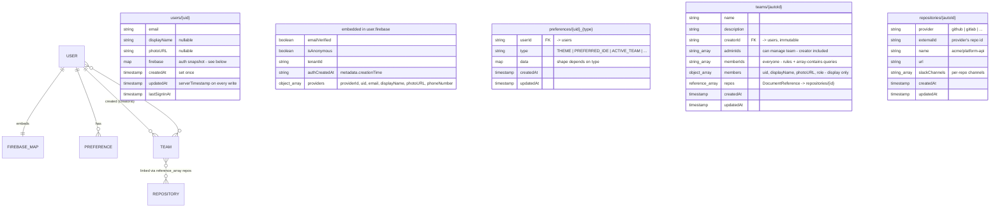

# Firestore Schema Plan

## Overview

Four collections: `users`, `preferences`, `teams`, `repositories`.

- Document IDs are auto-generated by Firestore (`doc.id`) — a UI mapper attaches
  `id` at read time (`{ id: doc.id, ...doc.data() }`). Exception: `users` docs are
  keyed by Firebase Auth `uid`, and `preferences` docs use a deterministic
  `{uid}_{type}` key for direct upserts.
- Never store credentials (Firebase `refreshToken`, OAuth tokens).

## Diagram



## Design decisions

- **`firebase` is an embedded map**, not a collection — a snapshot of the Firebase
  Auth `User` object (`providerData`, `metadata`, `emailVerified`, `isAnonymous`,
  `tenantId`). Refreshed on every sign-in; the `providers` array is ready for
  additional providers (GitHub, etc.) via `linkWithCredential`.
- **`memberIds` flat array is the membership source of truth.** Firestore rules
  and `array-contains` queries cannot inspect fields inside object arrays —
  `members[]` ({uid, displayName, photoURL, role}) exists only as a display
  snapshot, needed because user profiles are owner-only readable.
- **`creatorId` vs `adminIds`**: `creatorId` is immutable provenance; `adminIds`
  is the mutable management list. The creator is added to `adminIds` (and
  `memberIds`) at creation.
- **`repos` holds `DocumentReference` values**, not string IDs. Reads require a
  `getDoc` per ref (resolved by the UI mapper).
- **`preferences` is user-scoped only.** Team-scoped settings would be a separate
  collection to keep security rules simple.

## Security rules (paste into Firebase console)

```firestore
rules_version = '2';
service cloud.firestore {
  match /databases/{database}/documents {

    function signedIn() {
      return request.auth != null;
    }

    // ---------- users/{uid} ----------
    match /users/{userId} {
      allow get, list: if signedIn() && request.auth.uid == userId;

      allow create: if signedIn()
        && request.auth.uid == userId
        && request.resource.data.createdAt == request.time
        && request.resource.data.updatedAt == request.time
        && request.resource.data.keys().hasAll(
          ['email', 'firebase', 'createdAt', 'updatedAt', 'lastSignInAt']
        );

      allow update: if signedIn()
        && request.auth.uid == userId
        && request.resource.data.createdAt == resource.data.createdAt
        && request.resource.data.email == resource.data.email;

      allow delete: if false;
    }

    // ---------- preferences/{uid}_{type} ----------
    match /preferences/{prefId} {
      allow get, list: if signedIn()
        && resource.data.userId == request.auth.uid;

      allow create, update: if signedIn()
        && request.resource.data.userId == request.auth.uid
        && request.resource.data.updatedAt == request.time
        && request.resource.data.keys().hasAll(
          ['userId', 'type', 'data', 'createdAt', 'updatedAt']
        );

      allow delete: if signedIn()
        && resource.data.userId == request.auth.uid;
    }

    // ---------- teams/{teamId} ----------
    match /teams/{teamId} {
      allow get, list: if signedIn()
        && request.auth.uid in resource.data.memberIds;

      // Creator becomes admin + member atomically at create time
      allow create: if signedIn()
        && request.resource.data.creatorId == request.auth.uid
        && request.auth.uid in request.resource.data.adminIds
        && request.auth.uid in request.resource.data.memberIds;

      // Only admins may update; creatorId can never change
      allow update: if signedIn()
        && request.auth.uid in resource.data.adminIds
        && request.resource.data.creatorId == resource.data.creatorId
        && resource.data.creatorId in request.resource.data.memberIds;

      allow delete: if signedIn()
        && request.auth.uid == resource.data.creatorId;
    }

    // ---------- repositories/{repoId} ----------
    match /repositories/{repoId} {
      allow get, list: if signedIn();

      // TODO tighten: ideally restrict to admins of a linked team.
      // That requires querying teams inside the rule (get()), left open.
      allow create, update, delete: if signedIn();
    }
  }
}
```

## Open questions

- [ ] Does every user get an auto-created personal team on first sign-in
      ("{name}'s team"), or are teams created explicitly?
- [ ] Repository write rules: who may create/edit repos — team admins of a linked
      team only, or any signed-in user?
- [ ] When a user is removed from a team, must `members[]` snapshot cleanup
      happen atomically with `memberIds` (batched write), or do rules enforce
      consistency?
- [ ] Preference `type` enum — keep a TS union in code, or also validate allowed
      values in rules?
- [ ] Do we need `teamPreferences` (team-scoped settings) now or later?

## Code layout

Collections are a **data layer, not UI features** — so they don't each become a
`features/<name>/` folder. One module holds them, one file per collection, and
each file encapsulates everything about its collection (type, mapper, queries,
writes):

```
src/renderer/src/features/firestore/
  client.ts          # getDb() lazy init alongside getFirebaseAuth()
  users.ts           # AppUser type + userFromDoc() mapper + upsertUser()
  preferences.ts     # Preference type + PreferenceType union + prefFromDoc() + loadPreferences()
  teams.ts           # Team type + teamFromDoc() mapper + team queries/creates
  repositories.ts    # Repo type + repoFromDoc() mapper + repo queries
```

Features consume them: `auth` calls `upsertUser` on sign-in, dashboard/IDE
picker read via `loadPreferences`, etc. If a collection later grows real UI
(e.g. a Teams settings page), *that* becomes `features/teams/` — but the data
access stays here.

## Implementation plan (draft — not started)

1. **Rules** — paste the block above into Firebase console (Firestore → Rules).
2. **Collection files** — per layout above; each exports its type + `fromDoc`
   mapper (attaches `doc.id`) + read/write helpers.
3. **Firestore init** — `client.ts` with `getDb()`, same lazy pattern as
   `getFirebaseAuth()`.
4. **Sign-in upsert** — in `auth-provider.tsx`'s `onAuthStateChanged`: on user,
   `getDoc(users/{uid})` → create if missing, else refresh
   `lastSignInAt`/`updatedAt`/`providers`. Fire-and-forget — sign-in must not
   depend on this write.
5. **Load preferences** — after sign-in, `where('userId','==',uid)`; dispatch
   into UI state (theme, IDE, active team).
6. **Teams/repos wiring** — `where('memberIds','array-contains',uid)`, resolve
   `repos` refs; create-team flow sets `creatorId`, `adminIds`, `memberIds`,
   `members`.
