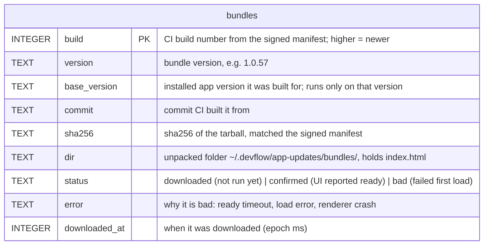
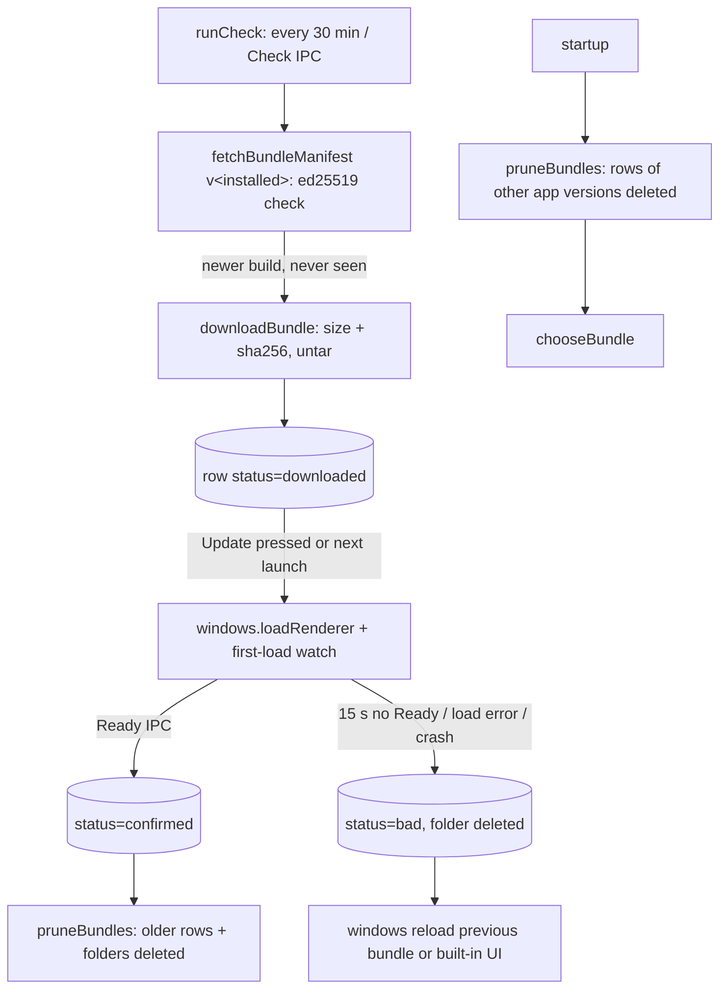

# App updates tables (`app-updates/db/tables`)

## `bundles`

One row per JS bundle this Mac downloaded, keyed by its CI build number. Written by
`downloadNewBundle` (`downloaded`), `confirmBundle` (`confirmed`), `rejectBundle` (`bad`) and
deleted by `pruneBundles`. The unpacked files are in `dir`; a row and its folder are deleted together.
`bad` rows are kept (without files) so the same build is never downloaded again.

```json
{
  "build": 57,
  "version": "1.0.57",
  "baseVersion": "1.0.42",
  "commit": "3f1c9e…",
  "sha256": "9b2d…",
  "dir": "/Users/ido/.devflow/app-updates/bundles/57",
  "status": "confirmed",
  "error": null,
  "downloadedAt": 1793361600000
}
```





## Scenarios

Run with the real main code in Electron (installed version `1.0.5`), a fake release server with
GitHub's URL layout, and releases made by `scripts/release/` with a test key.

| Situation                                           | Window loads                             | `bundles` rows after                                   | Snapshot                                           |
| --------------------------------------------------- | ---------------------------------------- | ------------------------------------------------------ | -------------------------------------------------- |
| No releases yet (404s)                              | built-in UI                              | none                                                   | no chip, no error                                  |
| Base `1.0.5` released, no bundle                    | built-in UI                              | none                                                   | no chip                                            |
| Bundle `1.0.7` published, check                     | built-in UI                              | 7 `downloaded`                                         | `readyBundle` 1.0.7 → **Update**                   |
| **Update** pressed, bundle sends `Ready`            | `bundles/7/index.html?view=main`         | 7 `confirmed`                                          | running 1.0.7, no chip                             |
| Broken bundle `1.0.9` (never sends `Ready`) applied | `bundles/9`, then after 15 s `bundles/7` | 9 `bad` ("no ready report within 15 s"), 7 `confirmed` | running 1.0.7                                      |
| Check again, manifest still 1.0.9                   | `bundles/7`                              | unchanged: 9 is not downloaded again                   | no chip                                            |
| Manifest payload edited after signing               | `bundles/7`                              | unchanged                                              | `lastError` "Bundle manifest signature is invalid" |
| Base `1.0.12` released (manifest still bad)         | `bundles/7`                              | unchanged                                              | `newBase` 1.0.12 → **New version**                 |
| Restart on `1.0.5`                                  | `bundles/7` directly                     | unchanged                                              | running 1.0.7                                      |
| Restart after installing the `1.0.12` .dmg          | built-in UI                              | none (7 and 9 pruned, folders deleted)                 | base 1.0.12, running 1.0.12                        |
