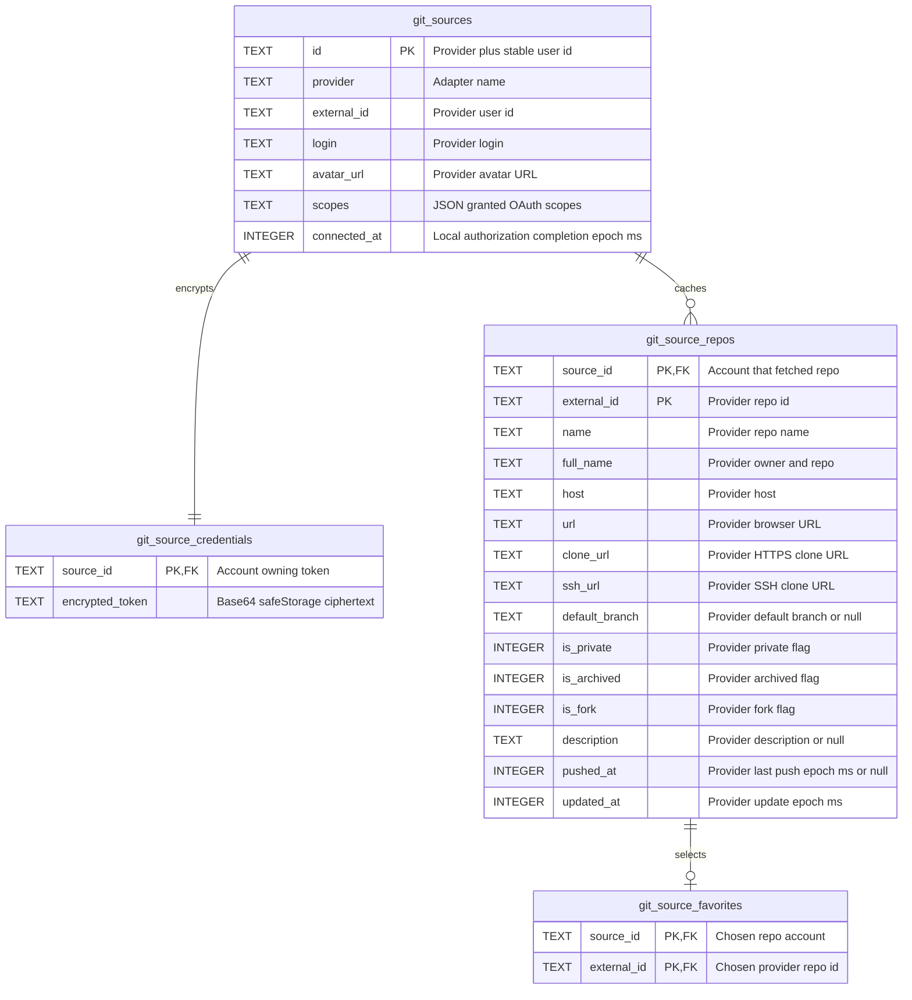
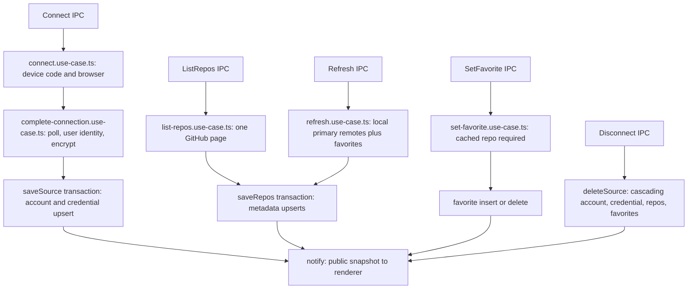

# Git source tables and verified scenarios

File: `~/.devflow/git-sources.db`. Each table folder has `schema.ts` (Drizzle + inferred `*DbEntity`), `queries.ts` and a README. No schema versions/migrations. Local clones and paths remain in `local-repos.db`.

| Table/folder                              | One row means                                           | Writes                                                               |
| ----------------------------------------- | ------------------------------------------------------- | -------------------------------------------------------------------- |
| `git_sources` / `git-sources/`            | An authorized provider account                          | Successful device flow upsert; disconnect delete                     |
| `git_source_credentials` / `credentials/` | An account's safeStorage ciphertext                     | Same transaction as account; cascades on disconnect                  |
| `git_source_repos` / `repos/`             | A cached provider repo accessible through one account   | Catalog page / selected refresh upsert; cascades on disconnect       |
| `git_source_favorites` / `favorites/`     | User explicitly chose this account/repo for the desktop | Favorite insert/unfavorite delete; cascades on repo/account deletion |

## Example rows

```json
{
  "git_sources": {
    "id": "github:1",
    "provider": "github",
    "externalId": "1",
    "login": "alice",
    "avatarUrl": "https://avatars.githubusercontent.com/u/1",
    "scopes": ["repo", "read:org"],
    "connectedAt": 1792920000000
  },
  "git_source_credentials": {
    "sourceId": "github:1",
    "encryptedToken": "<base64 OS-encrypted ciphertext; not a token>"
  },
  "git_source_repos": {
    "sourceId": "github:1",
    "externalId": "10",
    "name": "project",
    "fullName": "Acme/Project",
    "host": "github.com",
    "url": "https://github.com/Acme/Project",
    "cloneUrl": "https://github.com/Acme/Project.git",
    "sshUrl": "git@github.com:Acme/Project.git",
    "defaultBranch": "main",
    "isPrivate": true,
    "isArchived": false,
    "isFork": false,
    "description": null,
    "pushedAt": null,
    "updatedAt": 1792920000000
  },
  "git_source_favorites": { "sourceId": "github:1", "externalId": "10" }
}
```

DB/shared field names are camelCase, SQL names snake_case; Drizzle handles conversion without row mappers. `scopes` is JSON. Booleans use Drizzle boolean integer mode. Provider fields are facts; `connectedAt` is a local authorization event; favorites are explicit user preferences. No stored slug, merged repo, covered-local flag, card color, PR count or other invented repo facts. UI sort order is a separate localStorage preference.

## Relations (every column annotated)



## Write flow



## Scenarios checked by running code

Run `node scripts/check-git-sources.mjs`. The harness uses real Drizzle/SQLite and a temporary home, mocked HTTP and mocked OS encryption; it never resets or touches your real DB. Tested with the Electron Node runtime to match the installed SQLite native ABI.

| Scenario                                     | Accounts/credentials     | Cached repos            | Favorites        | Desktop result                                |
| -------------------------------------------- | ------------------------ | ----------------------- | ---------------- | --------------------------------------------- |
| Save same connection twice                   | One pair                 | Unchanged               | Unchanged        | No duplicates                                 |
| Browse/upsert same repo twice                | One pair                 | One row                 | None             | No remote card                                |
| Favorite twice                               | Unchanged                | One row                 | One row          | One remote card                               |
| Matching local clone (case-insensitive slug) | Unchanged                | One row                 | One row          | One local card, local id/path retained        |
| Two clones of same remote                    | Unchanged                | One row                 | One row          | Two local cards, no duplicate remote card     |
| Local fork differs from favorite upstream    | Unchanged                | One row                 | One row          | Separate fork/local and upstream/remote cards |
| Same repo through two accounts               | Two pairs                | Two account-scoped rows | Two rows         | One remote card                               |
| Repo renamed, stable id unchanged            | Unchanged                | Existing row updated    | Preserved        | Updated name, no new favorite row             |
| Unknown repo favorite                        | Unchanged                | Unchanged               | Rejected         | No invented repo                              |
| Unfavorite a local repo                      | Unchanged                | Preserved               | Deleted          | Local remains visible                         |
| Disconnect one account                       | Its pair deleted         | Its rows deleted        | Its rows deleted | Other account/local data unaffected           |
| 401 catalog request                          | Preserved                | Preserved               | Preserved        | Cache retained, reconnect error               |
| Catalog response arrives after disconnect    | Deleted                  | No rows recreated       | Deleted          | Disconnected data cannot return               |
| Device flow completes from two windows       | One pair                 | Unchanged               | Unchanged        | One shared completion pipeline                |
| Cancel pending authorization                 | Existing pairs preserved | Unchanged               | Unchanged        | Poll aborts, no new account                   |

Additional checks cover pagination, pending/slow-down/declined/expired authorization, aborts, FK integrity and absence of encrypted credentials/secret device codes in snapshots. A production keychain/browser flow and real GitHub org policies need manual verification with an OAuth App.
