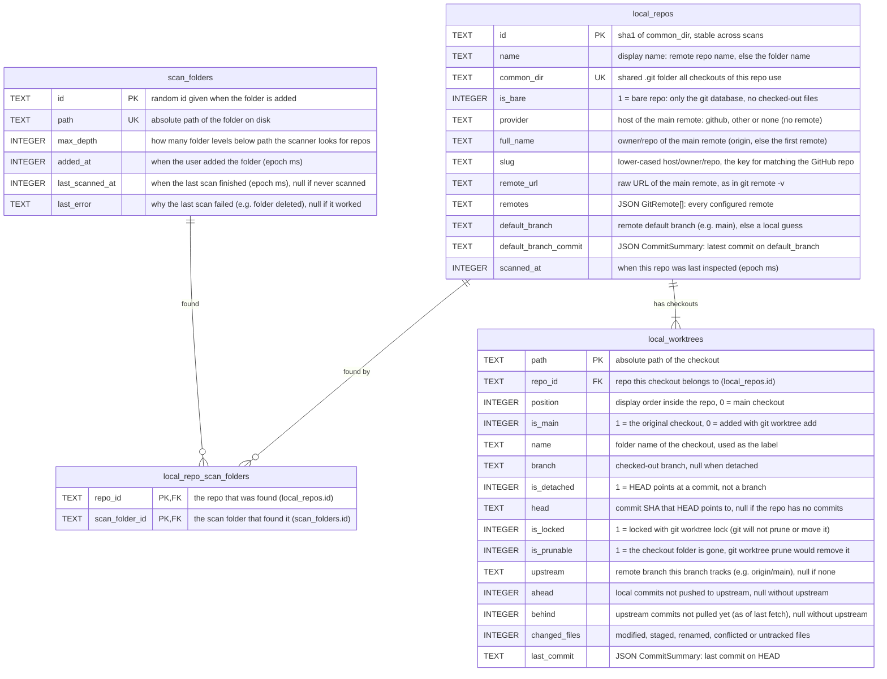
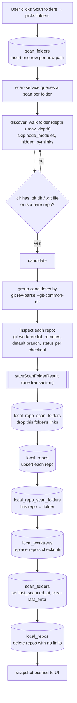

# Local repos database

The machine-local SQLite database behind the GitHub section's "local repositories" view.

- File: `~/.devflow/local-repos.db`
- Table files (this folder): [scan-folders.ts](scan-folders.ts), [local-repos.ts](local-repos.ts),
  [local-worktrees.ts](local-worktrees.ts), [local-repo-scan-folders.ts](local-repo-scan-folders.ts)
- Multi-table operations: [../index.ts](../index.ts) · connection and table creation:
  [../connection.ts](../connection.ts)
- App-facing types: [src/shared/local-repos/types.ts](../../../../shared/local-repos/types.ts)

None of this is synced to Firestore. Paths, branches and dirty state only make sense on this machine.

## Tables at a glance

| Table                     | One row is…                                               | Created/updated by                                |
| ------------------------- | --------------------------------------------------------- | ------------------------------------------------- |
| `scan_folders`            | a folder the user picked in **Scan folders**              | Add folders (`addScanFolders`); end of every scan |
| `local_repos`             | one git repository on disk (one shared `.git` dir)        | each scan (`saveScanFolderResult`)                |
| `local_worktrees`         | one checkout of a repo (main checkout or linked worktree) | each scan; replaced per repo                      |
| `local_repo_scan_folders` | "scan folder X found repo Y" (many-to-many link)          | each scan; used to delete repos no folder covers  |



Each column's comment says what it stores. Booleans are `0`/`1`, times are epoch ms, and `JSON …`
columns hold JSON text of the named type from `src/shared/local-repos/types.ts`.

Deleting a scan folder cascades to its link rows. Deleting a repo cascades to its link rows and
worktrees.

## How rows get created: the scan flow



A scan runs on app start, after folders are added, on **Rescan**, and on window focus (at most every
5 minutes). If a folder can't be scanned (e.g. deleted), its result is saved as empty and
`scan_folders.last_error` is set.

**Removing a scan folder** deletes its `scan_folders` row (which cascades to its links), then deletes
any `local_repos` row that no longer has a link. A repo also found by another folder stays.

## Tables in detail

Examples show one row as stored. Booleans are `0`/`1`, times are epoch ms, and nested objects are
JSON text (shown parsed here for readability).

### `scan_folders`

A folder the user chose to scan. It can be a single repo, a single worktree, or a parent folder of
many repos (e.g. `~/code`). `path` is unique, so adding the same folder twice is ignored.

```json
{
  "id": "7c1e0f3a-5d1b-4e8e-9a51-0b6f3c2d9e11",
  "path": "/Users/ido/code",
  "max_depth": 4,
  "added_at": 1792761181000,
  "last_scanned_at": 1792761190000,
  "last_error": null
}
```

### `local_repos`

One git repository on disk. All checkouts of the same repo (the main clone plus its linked
worktrees) share one `.git` directory (`common_dir`), so they collapse into one row. `id` is a hash
of `common_dir`, so it stays stable across scans.

`slug` is the normalized remote (`host/owner/repo`, see `utils/remote-url.ts`). It's the key for
matching this repo to its GitHub repo later. Repos without a remote have `provider: "none"` and a
null `slug`.

```json
{
  "id": "3fa1c09b2e7d4a10",
  "name": "the-garage-desktop-rn",
  "common_dir": "/Users/ido/code/the-garage-desktop-rn/.git",
  "is_bare": 0,
  "provider": "github",
  "full_name": "idotalmor/the-garage-desktop-rn",
  "slug": "github.com/idotalmor/the-garage-desktop-rn",
  "remote_url": "git@github.com:idotalmor/the-garage-desktop-rn.git",
  "remotes": [
    {
      "name": "origin",
      "url": "git@github.com:idotalmor/the-garage-desktop-rn.git",
      "host": "github.com",
      "owner": "idotalmor",
      "repo": "the-garage-desktop-rn",
      "slug": "github.com/idotalmor/the-garage-desktop-rn"
    }
  ],
  "default_branch": "main",
  "default_branch_commit": {
    "hash": "0474b92c1d…",
    "message": "Revert auto-close script on sign-in success page",
    "author": "Ido Talmor",
    "committedAt": 1792700000000
  },
  "scanned_at": 1792761190000
}
```

### `local_worktrees`

One checkout of a repo: the main checkout (`is_main: 1`) or a linked worktree created with
`git worktree add`. A linked worktree can live outside every scan folder; it's still found through
`git worktree list`. The rows for a repo are replaced on every scan, in `position` order (0 = main).

```json
{
  "path": "/Users/ido/code/worktrees/local-scanner",
  "repo_id": "3fa1c09b2e7d4a10",
  "position": 1,
  "name": "local-scanner",
  "is_main": 0,
  "branch": "review/local-scanner",
  "is_detached": 0,
  "head": "f73ce22a9b…",
  "is_locked": 0,
  "is_prunable": 0,
  "upstream": "origin/review/local-scanner",
  "ahead": 2,
  "behind": 0,
  "changed_files": 5,
  "last_commit": {
    "hash": "f73ce22a9b…",
    "message": "Split local-repos into modules",
    "author": "Ido Talmor",
    "committedAt": 1792761100000
  }
}
```

`is_prunable: 1` means the worktree's folder is gone (git can remove it with
`git worktree prune`). Its status fields stay empty.

### `local_repo_scan_folders`

The link between scan folders and repos (many-to-many). One repo can be found by several scan
folders (e.g. both `~/code` and `~/code/the-garage-desktop-rn`). It's stored once in `local_repos`,
and this table remembers who found it. A repo is deleted only when its last link is gone.

```json
{ "repo_id": "3fa1c09b2e7d4a10", "scan_folder_id": "7c1e0f3a-5d1b-4e8e-9a51-0b6f3c2d9e11" }
```

## What the UI receives

`listRepositories()` joins the tables into `LocalRepository` objects
(`src/shared/local-repos/types.ts`): one `local_repos` row + its `scanFolderIds` (from
`local_repo_scan_folders`) + its `worktrees` (from `local_worktrees`), camelCased and with JSON
parsed. The UI gets them inside `LocalReposSnapshot { scanFolders, repositories, scanning, progress }`.
