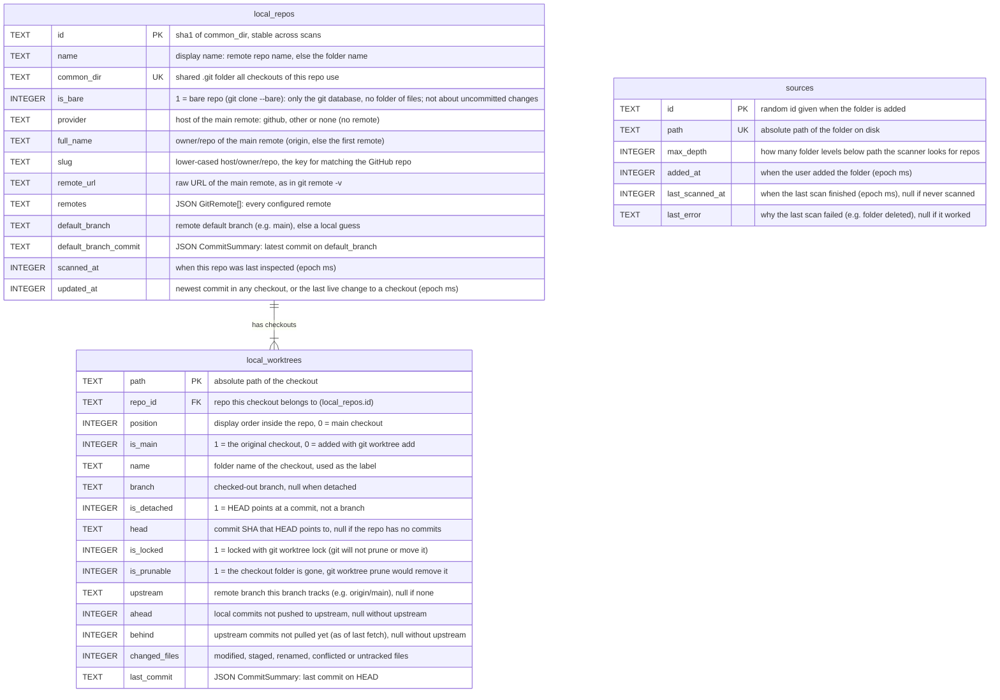
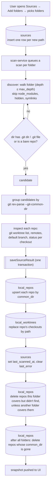
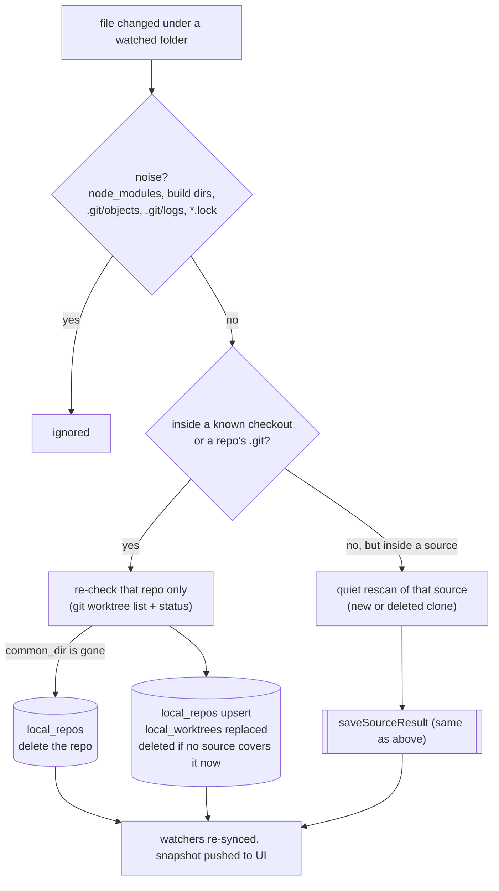

# Local repos database

The machine-local SQLite database behind the GitHub section's "local repositories" view.

- File: `~/.devflow/local-repos.db`
- Table files (this folder): [sources.ts](sources.ts), [local-repos.ts](local-repos.ts),
  [local-worktrees.ts](local-worktrees.ts)
- Multi-table operations: [../index.ts](../index.ts) · connection and table creation:
  [../connection.ts](../connection.ts)
- App-facing types: [src/shared/local-repos/types.ts](../../../../shared/local-repos/types.ts)

None of this is synced to Firestore. Paths, branches and dirty state only make sense on this machine.

There are no migrations yet. When a table changes, bump `SCHEMA_VERSION` in
[../connection.ts](../connection.ts): a DB with another version (`PRAGMA user_version`) is dropped
and recreated empty when the app opens it. **Reset local data** in the Sources dialog does the same
on demand: it drops every table in the file (including ones older builds left behind) and creates
them again empty.

## Tables at a glance

| Table             | One row is…                                               | Created/updated by                            |
| ----------------- | --------------------------------------------------------- | --------------------------------------------- |
| `sources`         | a folder the user added in **Sources**                    | Add folders (`addSources`); end of every scan |
| `local_repos`     | one git repository on disk (one shared `.git` dir)        | each scan (`saveSourceResult`)                |
| `local_worktrees` | one checkout of a repo (main checkout or linked worktree) | each scan; replaced per repo                  |

`sources` is only the list of folders to scan and watch. `local_repos` and `local_worktrees`
are what scanning and watching find. They are keyed by path (`common_dir`, `path`), so a repo or a
checkout is stored once, however many sources lead to it.

**Which sources cover a repo is not stored.** It is worked out from paths when reading
(`coveringSourceIds` in [../../utils/paths.ts](../../utils/paths.ts)): a source covers a
repo when the repo's `common_dir` or one of its existing (non-prunable) checkouts is inside it. A
repo that no source covers is deleted.



Each column's comment says what it stores. Booleans are `0`/`1`, times are epoch ms, and `JSON …`
columns hold JSON text of the named type from `src/shared/local-repos/types.ts` (typed `Json<T>` in the row types, see
[`../utils/json.ts`](../utils/json.ts)).

`sources` has no foreign keys: it is linked to repos only through paths. Deleting a repo
cascades to its worktrees.

## How rows get created: the scan flow



A full scan runs on app start, after folders are added, on **Rescan**, and on window focus (at most
every 5 minutes). If a folder can't be scanned (e.g. deleted), its result is saved as empty and
`sources.last_error` is set.

**Live updates (file watching).** `scan-service` watches every source recursively (FSEvents on
macOS), plus repo `.git` folders and checkouts that live outside all sources. Changes are
batched until the folder has been quiet for 1 s (at most 5 s):



**Removing a source** deletes its `sources` row, then deletes every `local_repos` row that
no remaining source covers. A repo another folder also covers stays.

**Reset local data** (`local-repos:reset`) waits for the running job, drops every table and creates
them again empty. Watchers are closed because no sources are left.

## Scenarios: what each situation stores

Each row is a real situation and the rows a scan leaves in each table. Rows 17–24 are live
changes picked up by the file watchers while the app runs; rows 25–28 check that nothing is stored
twice when sources overlap. These were checked by running
the scanner and DB code against real repos. `~` is the home folder, the remote is GitHub unless
noted, and "main" means `is_main = 1`.

| #   | Situation                                                                                                   | `sources`                                                          | `local_repos`                                                                                                                                   | covered by (computed)                              | `local_worktrees`                                                                                                                       |
| --- | ----------------------------------------------------------------------------------------------------------- | ------------------------------------------------------------------ | ----------------------------------------------------------------------------------------------------------------------------------------------- | -------------------------------------------------- | --------------------------------------------------------------------------------------------------------------------------------------- |
| 1   | Plain clone, no worktrees; pick the clone folder `~/code/app`                                               | `~/code/app`                                                       | `app`                                                                                                                                           | app ← `~/code/app`                                 | 1: `~/code/app` (main)                                                                                                                  |
| 2   | Pick a parent `~/code` with clones `app`, `api` and a non-repo folder                                       | `~/code`                                                           | `app`, `api`                                                                                                                                    | app ← `~/code`, api ← `~/code`                     | 1 each (main). The non-repo folder stores nothing                                                                                       |
| 3   | `~/code/app` plus worktrees `~/code/app-feat-a` and `~/code/app/.worktrees/feat-b`                          | `~/code`                                                           | `app` (one row: all three share one `.git`)                                                                                                     | app ← `~/code`                                     | 3: `~/code/app` (main), `app-feat-a`, `.worktrees/feat-b`. A worktree inside the clone counts as an untracked file in the main checkout |
| 4   | Pick only the clone `~/code/app`; its worktree is in `~/elsewhere/feat-x`                                   | `~/code/app`                                                       | `app`                                                                                                                                           | app ← `~/code/app`                                 | 2: `~/code/app` (main), `~/elsewhere/feat-x`. Found through `git worktree list`                                                         |
| 5   | Pick only a linked worktree `~/wt/feat-x`; the clone is `~/code/app` and another worktree is `~/wt2/feat-y` | `~/wt/feat-x`                                                      | `app`, `common_dir = ~/code/app/.git` (found by following the worktree's `.git` file)                                                           | app ← `~/wt/feat-x`                                | 3: `~/code/app` (main), `~/wt/feat-x`, `~/wt2/feat-y`                                                                                   |
| 6   | Bare repo `~/code/app.git` with worktrees `app-main` and `app-feat`                                         | `~/code`                                                           | `app`, `is_bare = 1`                                                                                                                            | app ← `~/code`                                     | 2, both `is_main = 0`. The bare repo has no files, so it has no worktree row                                                            |
| 7   | Two overlapping folders: `~/code` (has `app`, `api`) and `~/code/app`                                       | `~/code`, `~/code/app`                                             | `app`, `api` (app stored once)                                                                                                                  | app ← `~/code`, api ← `~/code`, app ← `~/code/app` | 1 each                                                                                                                                  |
| 7b  | …then remove `~/code`                                                                                       | `~/code/app`                                                       | `app` (still covered by `~/code/app`); `api` deleted                                                                                            | app ← `~/code/app`                                 | `api`'s row deleted                                                                                                                     |
| 7c  | …then remove `~/code/app`                                                                                   | empty                                                              | empty                                                                                                                                           | —                                                  | empty                                                                                                                                   |
| 8   | Repo with no remote, and a repo with a GitLab remote                                                        | `~/code`                                                           | `local-only`: `provider = none`, `slug = null`; `gl`: `provider = other`, `slug = gitlab.com/me/gl`                                             | each repo ← `~/code`                               | 1 each (main)                                                                                                                           |
| 9   | Same GitHub repo cloned twice: `~/a/app` and `~/b/app`                                                      | `~/a`, `~/b`                                                       | **2 rows**, different `common_dir`, same `slug = github.com/me/app`                                                                             | each clone ← its own folder                        | 1 each (main). Matching to GitHub later must group by `slug`                                                                            |
| 10  | Clone `api` deleted from disk, then a rescan                                                                | `~/code`                                                           | `api` deleted (`~/code` covers it but no longer finds it)                                                                                       | app ← `~/code` (api gone)                          | api's rows deleted                                                                                                                      |
| 11  | Worktree folder deleted without `git worktree remove`                                                       | `~/code`                                                           | `app`                                                                                                                                           | app ← `~/code`                                     | 2: main, plus the missing one with `is_prunable = 1` (status fields empty)                                                              |
| 12  | The source itself is deleted, then a rescan                                                                 | `~/code` kept, `last_error = "ENOENT: no such file or directory…"` | its repos deleted                                                                                                                               | —                                                  | empty                                                                                                                                   |
| 13  | Folder with no repos                                                                                        | `~/empty`, `last_error = null`                                     | none                                                                                                                                            | —                                                  | none                                                                                                                                    |
| 14  | Inside `~/code/app`: a submodule, a repo in `node_modules`, and an independent repo in `packages/inner`     | `~/code`                                                           | only `app`. Submodules and `node_modules` are skipped on purpose. **`packages/inner` is missed too**: the walk stops at the first repo it finds | app ← `~/code`                                     | 1: `~/code/app` (main)                                                                                                                  |
| 15  | Repo 5 levels below the source (`max_depth` is 4)                                                           | `~/code`                                                           | not found; a repo 4 levels down is found                                                                                                        | ok ← `~/code`                                      | only for the repo found                                                                                                                 |
| 16  | Worktree checked out at a commit (`--detach`), plus an uncommitted file in main                             | `~/code`                                                           | `app`                                                                                                                                           | app ← `~/code`                                     | main with `changed_files = 1`; detached one with `branch = null`, `is_detached = 1`                                                     |
| 17  | Live: `git worktree add ../app-feat` (inside the source)                                                    | unchanged                                                          | `app` re-checked                                                                                                                                | unchanged                                          | new row for `app-feat` within ~1 s                                                                                                      |
| 18  | Live: `git worktree add ~/elsewhere/far` (outside every source)                                             | unchanged                                                          | `app` re-checked                                                                                                                                | unchanged                                          | new row for `~/elsewhere/far`; it then gets its own watcher                                                                             |
| 19  | Live: edit a file in any checkout (inside or outside the sources)                                           | unchanged                                                          | that repo re-checked                                                                                                                            | unchanged                                          | that checkout's `changed_files` updates                                                                                                 |
| 20  | Live: commit or switch branch                                                                               | unchanged                                                          | that repo re-checked                                                                                                                            | unchanged                                          | `last_commit` / `branch` update                                                                                                         |
| 21  | Live: new clone appears in a source                                                                         | unchanged                                                          | new row                                                                                                                                         | api ← `~/code`                                     | new main row                                                                                                                            |
| 22  | Live: a clone is deleted                                                                                    | unchanged                                                          | row deleted (re-check fails → quiet folder rescan)                                                                                              | —                                                  | rows deleted                                                                                                                            |
| 23  | Live: `git worktree remove`                                                                                 | unchanged                                                          | `app` re-checked                                                                                                                                | unchanged                                          | that row deleted                                                                                                                        |
| 24  | Live: writes in `node_modules` / build folders                                                              | ignored, nothing re-checked                                        | —                                                                                                                                               | —                                                  | — (picked up on the repo's next real change)                                                                                            |
| 25  | `~/wt/feat-x` (only a linked worktree) and `~/code` (its main clone) both picked                            | 2 rows                                                             | 1 row (stored once)                                                                                                                             | app ← `~/wt/feat-x`, `~/code`                      | main + `~/wt/feat-x`                                                                                                                    |
| 25b | ...remove `~/code`                                                                                          | `~/wt/feat-x`                                                      | app kept (still covered through `~/wt/feat-x`)                                                                                                  | app ← `~/wt/feat-x`                                | unchanged                                                                                                                               |
| 25c | ...remove `~/wt/feat-x`                                                                                     | empty                                                              | empty                                                                                                                                           | —                                                  | empty                                                                                                                                   |
| 26  | `~/code/app` and `~/code` both picked, then app deleted from disk                                           | `~/code/app` keeps `last_error`                                    | 1 row, then deleted (its `common_dir` is gone)                                                                                                  | app ← both, then —                                 | deleted                                                                                                                                 |
| 27  | Worktree folder `~/code/x` deleted by hand, then a different repo cloned at `~/code/x`                      | `~/code`                                                           | app + other                                                                                                                                     | each ← `~/code`                                    | `~/code/x` stored once, now under other                                                                                                 |
| 28  | Only `~/wt/feat-x` picked, then `git worktree remove` it                                                    | `~/wt/feat-x` with `last_error`                                    | deleted (no source covers it)                                                                                                                   | —                                                  | deleted                                                                                                                                 |

## Tables in detail

Examples show one row as stored. Booleans are `0`/`1`, times are epoch ms, and nested objects are
JSON text (shown parsed here for readability).

### `sources`

A folder the user chose to scan. It can be a single repo, a single worktree, or a parent folder of
many repos (e.g. `~/code`). `path` is unique, so adding the same folder twice is ignored.

```json
{
  "id": "7c1e0f3a-5d1b-4e8e-9a51-0b6f3c2d9e11",
  "path": "/Users/ido/code",
  "max_depth": 4,
  "added_at": 1792761181000,
  "last_scanned_at": 1792761190000,
  "last_error": null
}
```

### `local_repos`

One git repository on disk. All checkouts of the same repo (the main clone plus its linked
worktrees) share one `.git` directory (`common_dir`), so they collapse into one row. `id` is a hash
of `common_dir`, so it stays stable across scans.

`slug` is the normalized remote (`host/owner/repo`, see `utils/remote-url.ts`). It's the key for
matching this repo to its GitHub repo later. Repos without a remote have `provider: "none"` and a
null `slug`.

```json
{
  "id": "3fa1c09b2e7d4a10",
  "name": "the-garage-desktop-rn",
  "common_dir": "/Users/ido/code/the-garage-desktop-rn/.git",
  "is_bare": 0,
  "provider": "github",
  "full_name": "idotalmor/the-garage-desktop-rn",
  "slug": "github.com/idotalmor/the-garage-desktop-rn",
  "remote_url": "git@github.com:idotalmor/the-garage-desktop-rn.git",
  "remotes": [
    {
      "name": "origin",
      "url": "git@github.com:idotalmor/the-garage-desktop-rn.git",
      "host": "github.com",
      "owner": "idotalmor",
      "repo": "the-garage-desktop-rn",
      "slug": "github.com/idotalmor/the-garage-desktop-rn"
    }
  ],
  "default_branch": "main",
  "default_branch_commit": {
    "hash": "0474b92c1d…",
    "message": "Revert auto-close script on sign-in success page",
    "author": "Ido Talmor",
    "committedAt": 1792700000000
  },
  "scanned_at": 1792761190000,
  "updated_at": 1792761100000
}
```

### `local_worktrees`

One checkout of a repo: the main checkout (`is_main: 1`) or a linked worktree created with
`git worktree add`. A linked worktree can live outside every source; it's still found through
`git worktree list`. The rows for a repo are replaced on every scan, in `position` order (0 = main).

```json
{
  "path": "/Users/ido/code/worktrees/local-scanner",
  "repo_id": "3fa1c09b2e7d4a10",
  "position": 1,
  "name": "local-scanner",
  "is_main": 0,
  "branch": "review/local-scanner",
  "is_detached": 0,
  "head": "f73ce22a9b…",
  "is_locked": 0,
  "is_prunable": 0,
  "upstream": "origin/review/local-scanner",
  "ahead": 2,
  "behind": 0,
  "changed_files": 5,
  "last_commit": {
    "hash": "f73ce22a9b…",
    "message": "Split local-repos into modules",
    "author": "Ido Talmor",
    "committedAt": 1792761100000
  }
}
```

`is_prunable: 1` means the worktree's folder is gone (git can remove it with
`git worktree prune`). Its status fields stay empty.

## What the UI receives

`listRepositories()` joins the tables into `LocalRepository` objects
(`src/shared/local-repos/types.ts`): one `local_repos` row + its `sourceIds` (worked out
from paths, see above) + its `worktrees` (from `local_worktrees`), camelCased and with JSON
parsed. The UI gets them inside `LocalReposSnapshot { sources, repositories, scanning, progress }`.
